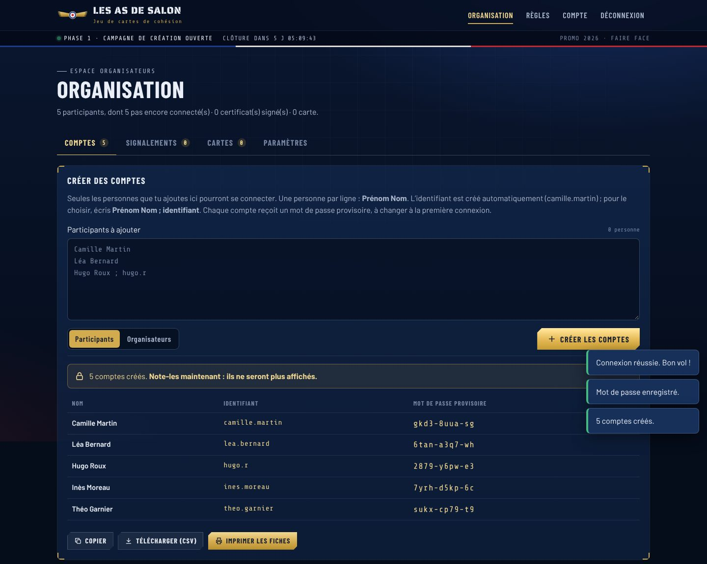
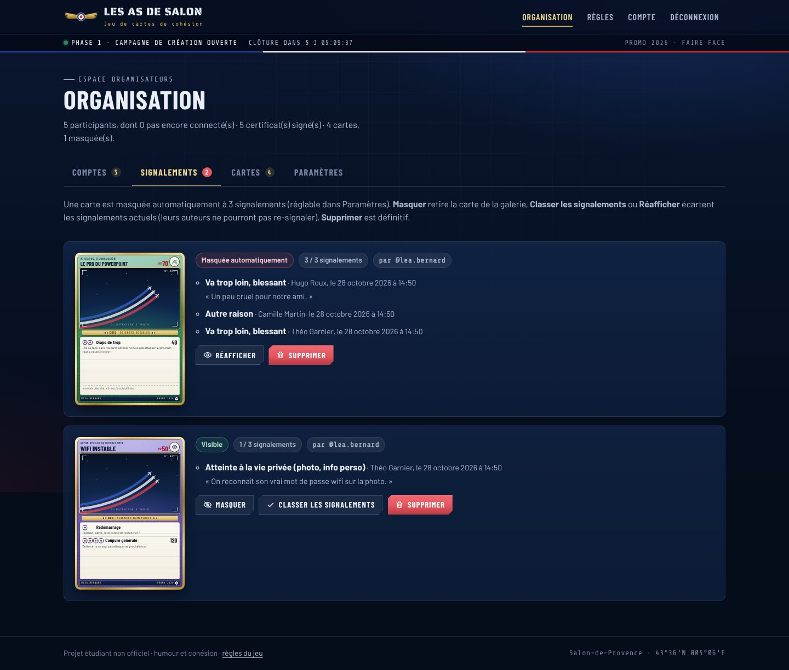

# Les As de Salon · Phase 1

Site de la **campagne de création** du jeu de cartes de cohésion. Les organisateurs créent un compte pour chaque participant choisi. Chaque participant signe le certificat de consentement, puis conçoit jusqu’à **5 cartes** dans un atelier avec aperçu en direct. Les cartes serviront au jeu de la phase 2.

Design inspiré de l’École de l’air de Salon-de-Provence : nuit de vol et instruments de bord, galons dorés, cocarde tricolore, fumées de la Patrouille de France. Projet étudiant non officiel.

| Organisation : création des comptes | Organisation : signalements |
| --- | --- |
|  |  |
| **Atelier de conception** | **Galerie** |
|  |  |

## Ce que fait le site

**Pour les participants**
- **Pas d’inscription libre** : on se connecte avec les identifiants donnés par les organisateurs, puis on choisit son propre mot de passe à la première connexion.
- **Certificat de consentement obligatoire** avant de créer ou de voir la moindre carte : six engagements à cocher, au nom enregistré par les organisateurs. Le certificat est numéroté et imprimable.
- **Registre des signataires** : la liste des personnes qu’on a le droit de mettre en scène sur une carte.
- **Atelier** : nom, sous-titre, filière, PV, illustration (recadrage et zoom), 1 ou 2 attaques, description. Aperçu en direct, jauge de puissance et « check-list prévol ».
- **Limite de 5 cartes** par personne, vérifiée par le serveur.
- **Galerie** avec filtres par filière, recherche, tri, et un bouton **Signaler** sur chaque carte.
- **Hangar** : ses propres cartes, compte à rebours de la campagne, statistiques par filière.
- **Retrait du consentement** : supprimer son compte efface ses cartes, ses signalements et son certificat.

**Pour les organisateurs** (menu Organisation)
- **Comptes** : création d’un ou plusieurs comptes en collant une liste de noms (« Prénom Nom », un par ligne). L’identifiant est généré automatiquement (camille.martin) et chaque compte reçoit un mot de passe provisoire. On peut ensuite copier les identifiants, les télécharger en CSV ou **imprimer des fiches à découper et distribuer**. La liste des comptes montre qui s’est connecté, qui a signé et combien de cartes chacun a créées. Elle permet aussi de corriger un nom, de donner un nouveau mot de passe (en cas d’oubli) ou de supprimer un compte. On peut aussi créer d’autres comptes organisateurs.
- **Signalements** : les cartes signalées, avec le motif, le commentaire et l’auteur de chaque signalement. Actions possibles : masquer, réafficher, classer les signalements, supprimer.
- **Cartes** : toutes les cartes, avec filtres par filière et par statut, et les mêmes actions.
- **Paramètres** : dates d’ouverture et de clôture de la campagne (bouton « ouvrir maintenant pour 7 jours »), seuil de masquage automatique, nom de la promo. Plus l’**export JSON** des cartes pour la phase 2.

## Filières

Les filières jouent le rôle des types Pokémon. Chacune donne sa couleur et son emblème à la carte :

| Filière | Domaine | Couleur |
| --- | --- | --- |
| **TESA** | Sciences techniques | orange, emblème engrenage |
| **NED** | Sciences numériques | violet, emblème puce électronique |
| **EGID** | Sciences sociales | vert, emblème groupe de personnes |

Les forces et faiblesses entre filières seront fixées pour la phase 2. La liste se modifie dans `shared/regles.js`.

## Équilibrage

Chaque carte a un **budget de 100 points de puissance** :
- PV de 30 à 150, par paliers de 10 : coût = PV ÷ 2 ;
- attaque : coût = dégâts ÷ 2, moins 5 par énergie après la première, plus le coût de l’effet (5 minimum) ;
- dégâts plafonnés à 40 par énergie (120 au maximum) ;
- effets choisis dans une liste fixe (Soin, Paralysie, Brouillage…), pour que le jeu puisse les appliquer. Les handicaps (Contrecoup, Épuisement) rendent 10 points. Le texte libre de l’attaque sert à l’humour.

Le navigateur et le serveur appliquent les mêmes règles (`shared/regles.js`), donc personne ne peut contourner le budget.

## Signalements

- Un signalement par personne et par carte, avec un motif. Il est anonyme pour l’auteur de la carte et visible des organisateurs.
- Au bout de **3 signalements** (réglable), la carte est masquée automatiquement. Seul son auteur la voit encore, avec les motifs, et peut la supprimer pour en créer une autre. Une carte masquée ne peut plus être modifiée.
- Les organisateurs traitent ensuite les signalements dans l’onglet du même nom : masquer une carte même sous le seuil, la réafficher en classant les signalements (les mêmes personnes ne pourront pas la re-signaler), ou la supprimer.

## Lancer le site

Il faut **Node.js 22.13 ou plus récent** (la base SQLite est intégrée à Node, rien d’autre à installer).

```bash
npm install
```

```bash
npm start
```

Le site tourne alors sur http://localhost:3000.

### Premier démarrage : le compte organisateur

Au tout premier démarrage, le serveur crée le compte organisateur et affiche son mot de passe provisoire dans la console :

```
   ┌──────────────────────────────────────────┐
   │  Compte organisateur créé                │
   │  Identifiant : admin                     │
   │  Mot de passe provisoire : k7mp-3qxt-9r  │
   │  À changer à la première connexion.      │
   └──────────────────────────────────────────┘
```

Connecte-toi avec ces identifiants, choisis ton mot de passe, puis crée les comptes des participants dans **Organisation › Comptes**.

Si le mot de passe organisateur est perdu, cette commande en génère un nouveau (et crée le compte s’il n’existe plus) :

```bash
npm run compte-admin
```

Si tu veux aussi jouer, crée-toi un compte participant séparé : le compte organisateur ne conçoit pas de cartes.

### Sauvegarde et tests

La base de données est un seul fichier, `data/as-de-salon.sqlite` : pour la sauvegarder, il suffit de le copier. Rechargement automatique pendant le développement : `npm run dev`. Tests : `npm test`.

## Configuration (`.env`)

Copier `.env.example` en `.env`. Toutes les valeurs sont facultatives.

| Variable | Rôle | Par défaut |
| --- | --- | --- |
| `NOM_JEU` | Nom affiché | `Les As de Salon` |
| `ADMIN_IDENTIFIANT` | Identifiant du compte organisateur créé au premier démarrage | `admin` |
| `ADMIN_MOT_DE_PASSE` | Son mot de passe provisoire (sinon généré et affiché dans la console) | généré |
| `PROMO`, `SEUIL_SIGNALEMENTS`, `CAMPAGNE_DEBUT`, `CAMPAGNE_FIN` | Valeurs de départ, modifiables ensuite dans Organisation › Paramètres | vide, `3`, campagne toujours ouverte |
| `PORT`, `DB_PATH` | Port HTTP et chemin de la base | `3000`, `data/as-de-salon.sqlite` |
| `NODE_ENV=production` | Cookies `Secure` (HTTPS obligatoire) | — |
| `TRUST_PROXY` | À mettre à `1` derrière un proxy HTTPS (Render, Railway, Nginx…) | désactivé |

## Mise en ligne

N’importe quel hébergeur Node.js convient (Render, Railway, Fly.io, un VPS…), à deux conditions :

- un **disque persistant** pour le fichier SQLite (sinon les comptes et les cartes disparaissent à chaque redéploiement) : pointer `DB_PATH` dessus ;
- le site servi en **HTTPS**, avec `NODE_ENV=production` et `TRUST_PROXY=1`.

Commande de démarrage : `npm start`. Le mot de passe provisoire de l’organisateur apparaît dans les journaux (logs) de l’hébergeur au premier démarrage. Le site tourne sur une seule instance (les limites anti-abus sont gardées en mémoire).

## Organisation du code

```
shared/        Règles partagées navigateur + serveur
  regles.js      budget, filières, effets, validation d'une carte
  certificat.js  texte et version du certificat de consentement
  exemples.js    cartes d'exemple (accueil, règles)
server/        API Express + SQLite (node:sqlite)
  comptes.js     création des comptes, mots de passe provisoires, compte organisateur
  compte-admin.js  commande de secours npm run compte-admin
  routes/        connexion et certificat, cartes et signalements, organisation
public/        Site (HTML, CSS et JavaScript sans étape de build)
  css/carte.css  design des cartes
  js/pages/      une page par écran (admin.js = espace organisateurs)
test/          Tests (node --test)
```

## Sécurité et vie privée

- Comptes créés uniquement par les organisateurs ; mot de passe provisoire obligatoirement remplacé à la première connexion.
- Mots de passe hachés avec scrypt ; les mots de passe provisoires ne sont affichés qu’une fois. Une réinitialisation déconnecte la personne de tous ses appareils.
- Sessions en cookie `HttpOnly` et `SameSite=Lax`. Écritures acceptées seulement en JSON et depuis le site lui-même (protection CSRF). En-têtes de sécurité stricts (CSP sans script externe) et polices hébergées sur le site.
- Les cartes et le registre ne sont visibles qu’après connexion et signature du certificat.
- Les images sont réduites (900 px) et réencodées dans le navigateur avant l’envoi, ce qui retire leurs métadonnées (position GPS…). Le serveur vérifie le format et la taille (1,5 Mo max).
- Limites anti-abus larges par adresse IP (toute une promo peut partager le même Wi-Fi), et limite des échecs de connexion par compte.
