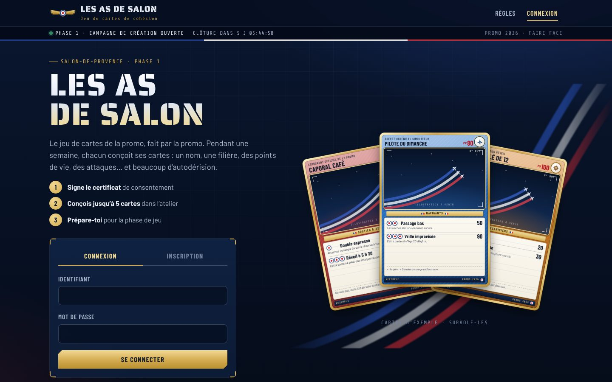
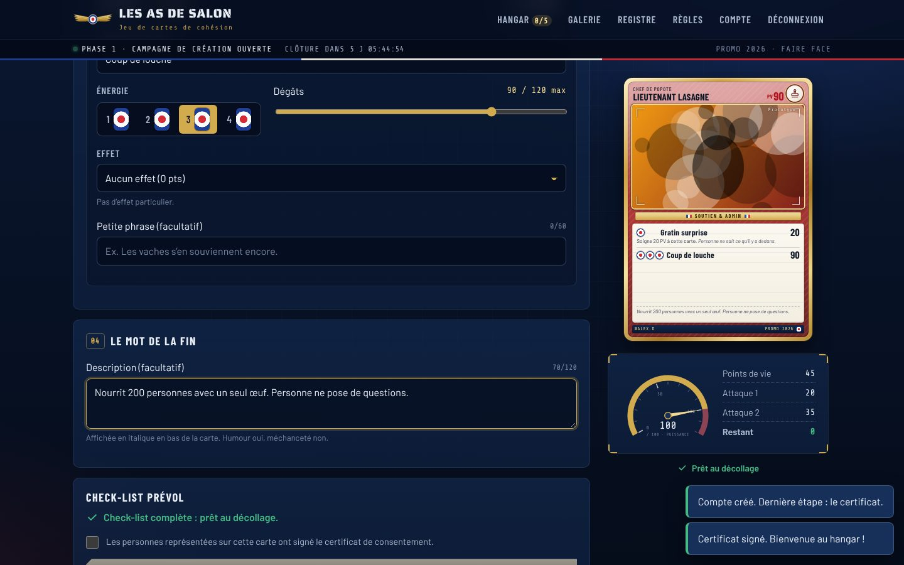
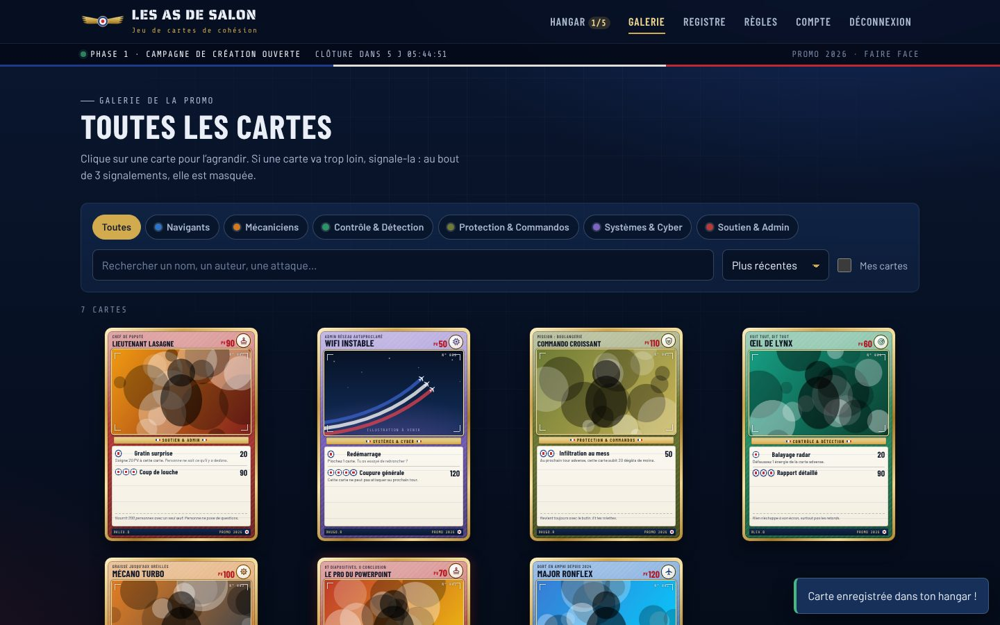
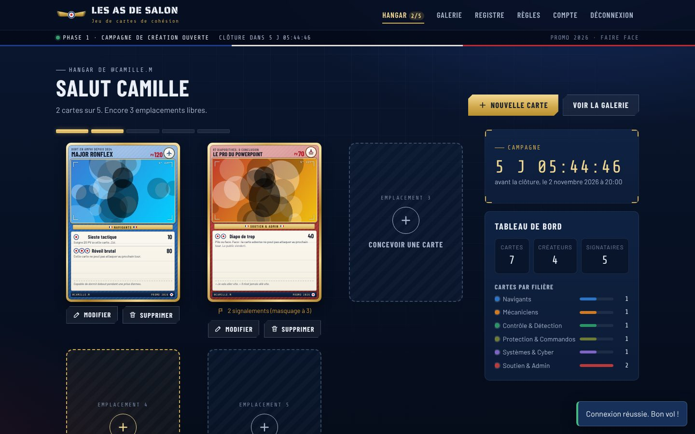

# Les As de Salon · Phase 1

Site de la **campagne de création** du jeu de cartes de cohésion : chaque participant crée un compte, signe le certificat de consentement, puis conçoit jusqu’à **5 cartes** dans un atelier avec aperçu en direct. Les cartes serviront au jeu de la phase 2.

Design inspiré de l’École de l’air de Salon-de-Provence : nuit de vol et instruments de bord, galons dorés, cocarde tricolore, fumées de la Patrouille de France. Projet étudiant non officiel.

| Accueil | Atelier de conception |
| --- | --- |
|  |  |
| **Galerie** | **Hangar (cartes de l’utilisateur)** |
|  |  |

## Ce que fait le site

- **Comptes** : inscription avec identifiant et mot de passe, code d’accès de promo facultatif.
- **Certificat de consentement obligatoire** avant toute création ou consultation de carte. Six engagements à cocher, signature avec prénom et nom, certificat numéroté et imprimable. Changer la version du texte oblige tout le monde à signer à nouveau.
- **Registre des signataires** : la liste des personnes qu’on a le droit de mettre en scène sur une carte.
- **Atelier** : nom, sous-titre, filière, PV, illustration (recadrage et zoom), 1 ou 2 attaques, description. Aperçu en direct, jauge de puissance et « check-list prévol ».
- **Limite de 5 cartes** par personne, vérifiée par le serveur.
- **Galerie** avec filtres par filière, recherche et tri, et un bouton **Signaler** sur chaque carte.
- **Hangar** : ses propres cartes, compte à rebours de la campagne et statistiques par filière.
- **Dates de campagne** : création et modification possibles seulement pendant la semaine prévue. La suppression reste toujours possible.
- **Retrait du consentement** : supprimer son compte efface ses cartes, ses signalements et son certificat.
- **Espace organisateurs** (facultatif) : cartes signalées, rétablissement en cas d’abus, export JSON des cartes pour la phase 2.

## Réponses aux points à clarifier

Ce sont des choix par défaut, tous réglables.

1. **Signalements sans modérateur.** Une carte est **masquée automatiquement après 3 signalements** de personnes différentes (`SEUIL_SIGNALEMENTS`). Un signalement par personne et par carte, avec un motif, anonyme pour l’auteur. L’auteur voit sa carte masquée avec les motifs et peut la supprimer pour libérer la place. Une carte masquée ne peut plus être modifiée, ce qui évite de la « blanchir » en changeant une virgule. Les organisateurs listés dans `ADMINS` n’interviennent qu’en cas d’abus : ils peuvent rétablir une carte victime de signalements en série, ou supprimer un contenu grave.
2. **Phases.** Ce site couvre la phase 1 (création, 1 semaine, dates dans `CAMPAGNE_DEBUT` et `CAMPAGNE_FIN`). Le bandeau du site affiche un compte à rebours. La phase 2 et ses fenêtres d’ajout restent à construire.
3. **Filières.** Six filières provisoires, chacune avec sa couleur et son emblème : Navigants, Mécaniciens, Contrôle & Détection, Protection & Commandos, Systèmes & Cyber, Soutien & Admin. À remplacer par les vraies filières dans `shared/regles.js`. Le tableau des forces et faiblesses n’est pas encore fixé : il servira en phase 2.
4. **Équilibrage.** Chaque carte a un **budget de 100 points de puissance** :
   - PV de 30 à 150, par paliers de 10 : coût = PV ÷ 2 ;
   - attaque : coût = dégâts ÷ 2, moins 5 par énergie après la première, plus le coût de l’effet (5 minimum) ;
   - dégâts plafonnés à 40 par énergie (120 au maximum) ;
   - effets choisis dans une liste fixe (Soin, Paralysie, Brouillage…), pour que le jeu puisse les appliquer. Les handicaps (Contrecoup, Épuisement) rendent 10 points. Le texte libre de l’attaque sert à l’humour.

   Le navigateur et le serveur appliquent les mêmes règles (`shared/regles.js`), donc personne ne peut contourner le budget.

## Lancer le site

Il faut **Node.js 22.13 ou plus récent** (la base SQLite est intégrée à Node, rien d’autre à installer).

```bash
npm install
```

```bash
cp .env.example .env
```

```bash
npm start
```

Le site tourne alors sur http://localhost:3000. La base de données est un seul fichier, `data/as-de-salon.sqlite`. Pour la sauvegarder, il suffit de copier ce fichier.

Pour développer avec rechargement automatique : `npm run dev`. Pour lancer les tests : `npm test`.

## Configuration (`.env`)

| Variable | Rôle | Par défaut |
| --- | --- | --- |
| `NOM_JEU` | Nom affiché | `Les As de Salon` |
| `PROMO` | Nom de la promo, imprimé en bas des cartes | vide |
| `CAMPAGNE_DEBUT`, `CAMPAGNE_FIN` | Dates de la campagne de création (ISO, avec fuseau) | ouverte en permanence |
| `SEUIL_SIGNALEMENTS` | Nombre de signalements qui masquent une carte | `3` |
| `CODE_ACCES` | Code demandé à l’inscription | inscription libre |
| `ADMINS` | Identifiants des organisateurs, séparés par des virgules | aucun |
| `PORT`, `DB_PATH` | Port HTTP et chemin de la base | `3000`, `data/as-de-salon.sqlite` |
| `NODE_ENV=production` | Cookies `Secure` (HTTPS obligatoire) | — |
| `TRUST_PROXY` | À mettre à `1` derrière un proxy HTTPS (Render, Railway, Nginx…) | désactivé |

## Mise en ligne

N’importe quel hébergeur Node.js convient (Render, Railway, Fly.io, un VPS…), à deux conditions :

- un **disque persistant** pour le fichier SQLite (sinon les cartes disparaissent à chaque redéploiement) : pointer `DB_PATH` dessus ;
- le site servi en **HTTPS** avec `NODE_ENV=production` et `TRUST_PROXY=1`.

Commande de démarrage : `npm start`. Le site tourne sur une seule instance (les limites anti-abus sont gardées en mémoire).

## Organisation du code

```
shared/        Règles partagées navigateur + serveur
  regles.js      budget, filières, effets, validation d'une carte
  certificat.js  texte et version du certificat de consentement
  exemples.js    cartes d'exemple (accueil, règles)
server/        API Express + SQLite (node:sqlite)
  routes/        compte et certificat, cartes et signalements, organisateurs
public/        Site (HTML, CSS et JavaScript sans étape de build)
  css/carte.css  design des cartes
  js/pages/      une page par écran
test/          Tests (node --test)
```

## Sécurité et vie privée

- Mots de passe hachés avec scrypt ; sessions en cookie `HttpOnly` et `SameSite=Lax`.
- Écritures acceptées seulement en JSON et depuis le site lui-même (protection CSRF), en-têtes de sécurité stricts (CSP sans script externe), polices hébergées sur le site.
- Toutes les cartes et le registre ne sont visibles qu’après connexion et signature du certificat.
- Les images sont réduites (900 px) et réencodées dans le navigateur avant l’envoi : les métadonnées (position GPS…) sont retirées. Le serveur vérifie le format et la taille (1,5 Mo max).
- Limites anti-abus larges par adresse IP (toute une promo peut partager le même Wi-Fi), et limite des échecs de connexion par compte.
