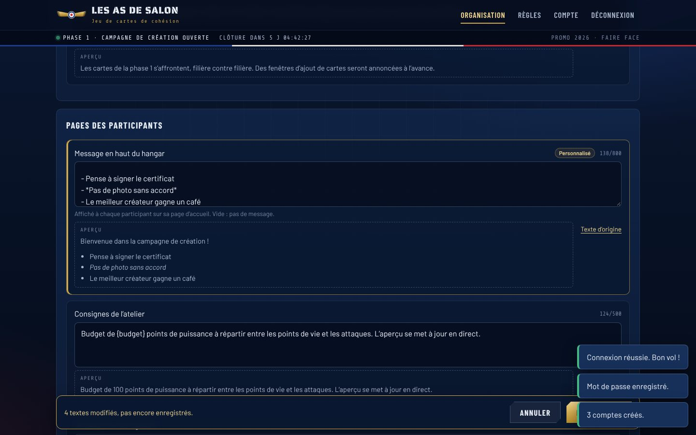
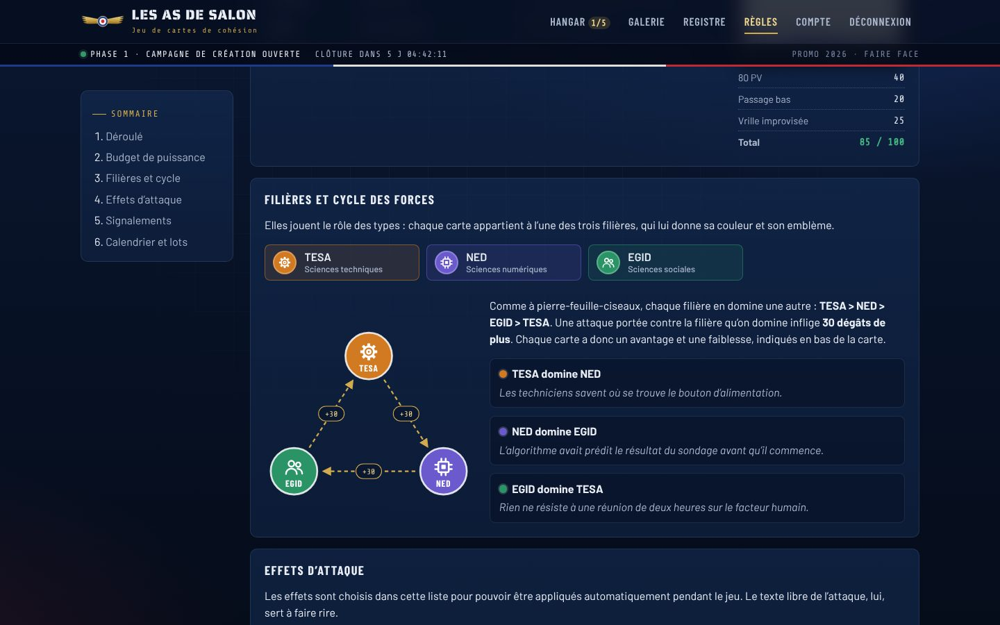

# Les As de Salon · Phase 1

Site de la **campagne de création** du jeu de cartes de cohésion. Les organisateurs créent un compte pour chaque participant choisi. Chaque participant signe le certificat de consentement, puis conçoit jusqu’à **5 cartes** dans un atelier avec aperçu en direct. Les cartes serviront au jeu de la phase 2.

Design inspiré de l’École de l’air de Salon-de-Provence : nuit de vol et instruments de bord, galons dorés, cocarde tricolore, fumées de la Patrouille de France. Projet étudiant non officiel.

| Organisation : création des comptes | Organisation : signalements |
| --- | --- |
|  |  |
| **Atelier de conception** | **Galerie** |
|  |  |
| **Personnalisation des textes** | **Cycle des filières (règles)** |
|  |  |

## Ce que fait le site

**Pour les participants**
- **Pas d’inscription libre** : on se connecte avec les identifiants donnés par les organisateurs, puis on choisit son propre mot de passe à la première connexion.
- **Certificat de consentement obligatoire** avant de créer ou de voir la moindre carte : six engagements à cocher, au nom enregistré par les organisateurs. Le certificat est numéroté et imprimable.
- **Registre des signataires** : la liste des personnes qu’on a le droit de mettre en scène sur une carte.
- **Atelier** : nom, sous-titre, filière, PV, illustration (recadrage et zoom), 1 ou 2 attaques, description. Aperçu en direct, jauge de puissance et « check-list prévol ».
- **Limite de 5 cartes** par personne, vérifiée par le serveur.
- **Galerie** avec filtres par filière, recherche, tri, et un bouton **Signaler** sur chaque carte.
- **Hangar** : ses propres cartes, compte à rebours de la campagne, statistiques par filière.
- **Retrait du consentement** : supprimer son compte efface ses cartes, ses signalements et son certificat.

**Pour les organisateurs** (menu Organisation)
- **Comptes** : création d’un ou plusieurs comptes en collant une liste de noms (« Prénom Nom », un par ligne). L’identifiant est généré automatiquement (camille.martin) et chaque compte reçoit un mot de passe provisoire. On peut ensuite copier les identifiants, les télécharger en CSV ou **imprimer des fiches à découper et distribuer**. La liste des comptes montre qui s’est connecté, qui a signé et combien de cartes chacun a créées. Elle permet aussi de corriger un nom, de donner un nouveau mot de passe (en cas d’oubli) ou de supprimer un compte. On peut aussi créer d’autres comptes organisateurs.
- **Signalements** : les cartes signalées, avec le motif, le commentaire et l’auteur de chaque signalement. Actions possibles : masquer, réafficher, classer les signalements, supprimer.
- **Cartes** : toutes les cartes, avec filtres par filière et par statut, et les mêmes actions.
- **Paramètres** : dates d’ouverture et de clôture de la campagne (bouton « ouvrir maintenant pour 7 jours »), seuil de masquage automatique, nom de la promo. Plus l’**export JSON** des cartes pour la phase 2.
- **Personnalisation** : les textes du site, modifiables sans toucher au code (voir plus bas).

## Filières

Les filières jouent le rôle des types Pokémon. Chacune donne sa couleur et son emblème à la carte :

| Filière | Domaine | Couleur |
| --- | --- | --- |
| **TESA** | Sciences techniques | orange, emblème engrenage |
| **NED** | Sciences numériques | violet, emblème puce électronique |
| **EGID** | Sciences sociales | vert, emblème groupe de personnes |

### Cycle des forces : TESA > NED > EGID > TESA

Comme à pierre-feuille-ciseaux, chaque filière en domine une autre. Une attaque portée contre la filière qu’on domine inflige **+30 dégâts**. Chaque carte affiche en bas son **avantage** (la filière qu’elle domine) et sa **faiblesse** (celle qui la domine).

| Filière | Avantage contre | Faiblesse face à |
| --- | --- | --- |
| TESA | NED | EGID |
| NED | EGID | TESA |
| EGID | TESA | NED |

La page Règles montre le cycle en schéma, avec une phrase humoristique pour chaque avantage (modifiable dans Personnalisation). Le calcul pour la phase 2 est prêt : `degatsInfliges(degats, filiereAttaquant, filiereDefenseur)` dans `shared/regles.js`, où se règlent aussi l’ordre du cycle (`CYCLE`) et le bonus (`BONUS_AVANTAGE`).

## Équilibrage

Chaque carte a un **budget de 100 points de puissance** :
- PV de 30 à 150, par paliers de 10 : coût = PV ÷ 2 ;
- attaque : coût = dégâts ÷ 2, moins 5 par énergie après la première, plus le coût de l’effet (5 minimum) ;
- dégâts plafonnés à 40 par énergie (120 au maximum) ;
- effets choisis dans une liste fixe (Soin, Paralysie, Brouillage…), pour que le jeu puisse les appliquer. Les handicaps (Contrecoup, Épuisement) rendent 10 points. Le texte libre de l’attaque sert à l’humour.

Le navigateur et le serveur appliquent les mêmes règles (`shared/regles.js`), donc personne ne peut contourner le budget.

## Signalements

- Un signalement par personne et par carte, avec un motif. Il est anonyme pour l’auteur de la carte et visible des organisateurs.
- Au bout de **3 signalements** (réglable), la carte est masquée automatiquement. Seul son auteur la voit encore, avec les motifs, et peut la supprimer pour en créer une autre. Une carte masquée ne peut plus être modifiée.
- Les organisateurs traitent ensuite les signalements dans l’onglet du même nom : masquer une carte même sous le seuil, la réafficher en classant les signalements (les mêmes personnes ne pourront pas la re-signaler), ou la supprimer.

## Personnaliser le site sans toucher au code

Dans **Organisation › Personnalisation**, les organisateurs modifient les textes vus par les participants :

- **Partout** : nom du jeu, sous-titre du logo, **annonce** affichée en haut de toutes les pages (« Clôture dimanche à 20 h ! »), pied de page ;
- **Accueil** : présentation, les trois étapes, message sous la connexion, description des phases ;
- **Pages des participants** : message des organisateurs en haut du hangar, consignes de l’atelier, introduction de la galerie et du certificat ;
- **Règles** : introduction, phrases du cycle des filières, et une **section libre** (calendrier, lots à gagner…).

Chaque texte a un aperçu en direct et un bouton « Texte d’origine ». Un texte vide ne s’affiche pas. Mise en forme possible : `**gras**`, `*italique*`, `[lien](https://…)`, listes avec `- `. Des variables restent à jour toutes seules : `{nomJeu}`, `{promo}`, `{limiteCartes}`, `{seuil}`, `{budget}`. Le HTML saisi n’est jamais interprété (pas de risque d’injecter du code).

Le design, les règles du jeu et les engagements du certificat ne se modifient pas depuis le site : changer un engagement obligerait tout le monde à signer à nouveau. La liste des textes modifiables est dans `shared/textes.js` : pour en ajouter un, il suffit d’y déclarer une entrée et de l’afficher dans la page voulue.

## Lancer le site

Il faut **Node.js 22.13 ou plus récent** (la base SQLite est intégrée à Node, rien d’autre à installer).

```bash
npm install
```

```bash
npm start
```

Le site tourne alors sur http://localhost:3000.

### Premier démarrage : le compte organisateur

Au tout premier démarrage, le serveur crée le compte organisateur et affiche son mot de passe provisoire dans la console :

```
   ┌──────────────────────────────────────────┐
   │  Compte organisateur créé                │
   │  Identifiant : admin                     │
   │  Mot de passe provisoire : k7mp-3qxt-9r  │
   │  À changer à la première connexion.      │
   └──────────────────────────────────────────┘
```

Connecte-toi avec ces identifiants, choisis ton mot de passe, puis crée les comptes des participants dans **Organisation › Comptes**.

Si le mot de passe organisateur est perdu, cette commande en génère un nouveau (et crée le compte s’il n’existe plus) :

```bash
npm run compte-admin
```

Si tu veux aussi jouer, crée-toi un compte participant séparé : le compte organisateur ne conçoit pas de cartes.

### Sauvegarde et tests

La base de données est un seul fichier, `data/as-de-salon.sqlite` : pour la sauvegarder, il suffit de le copier. Rechargement automatique pendant le développement : `npm run dev`. Tests : `npm test`.

## Configuration (`.env`)

Copier `.env.example` en `.env`. Toutes les valeurs sont facultatives.

| Variable | Rôle | Par défaut |
| --- | --- | --- |
| `NOM_JEU` | Nom affiché par défaut (modifiable ensuite dans Organisation › Personnalisation) | `Les As de Salon` |
| `ADMIN_IDENTIFIANT` | Identifiant du compte organisateur créé au premier démarrage | `admin` |
| `ADMIN_MOT_DE_PASSE` | Son mot de passe provisoire (sinon généré et affiché dans la console) | généré |
| `PROMO`, `SEUIL_SIGNALEMENTS`, `CAMPAGNE_DEBUT`, `CAMPAGNE_FIN` | Valeurs de départ, modifiables ensuite dans Organisation › Paramètres | vide, `3`, campagne toujours ouverte |
| `DEMO`, `DEMO_MOT_DE_PASSE` | `DEMO=1` : site de démonstration, avec des participants et des cartes fictifs créés au démarrage si la base n’a encore aucun participant. Ne jamais l’activer pour la vraie campagne | désactivé |
| `PORT`, `DB_PATH` | Port HTTP et chemin de la base | `3000`, `data/as-de-salon.sqlite` |
| `NODE_ENV=production` | Cookies `Secure` (HTTPS obligatoire) | — |
| `TRUST_PROXY` | À mettre à `1` derrière un proxy HTTPS (Render, Railway, Nginx…) | désactivé |

## Voir ses modifications sur le site

Trois outils s’enchaînent pour qu’une modification faite sur GitHub soit visible en ligne.

### 1. Les tests automatiques (déjà actifs)

À chaque modification poussée sur GitHub, même depuis l’éditeur de github.com, les tests se lancent tout seuls (`.github/workflows/tests.yml`). Une **coche verte** ou une **croix rouge** apparaît à côté du commit et dans l’onglet **Actions**. Croix rouge : la modification casse quelque chose, et le site en ligne n’est pas mis à jour.

### 2. Le site en ligne, mis à jour tout seul (Render)

À faire une seule fois, environ 5 minutes :

1. Créer un compte gratuit sur [render.com](https://render.com) avec « Sign in with GitHub », et autoriser l’accès au dépôt `CardCreationPhase1`.
2. Dans Render : **New › Blueprint**, choisir le dépôt. Render lit le fichier `render.yaml`.
3. Render demande deux mots de passe : `ADMIN_MOT_DE_PASSE` (compte organisateur) et `DEMO_MOT_DE_PASSE` (participants fictifs). Choisis-en deux de 8 caractères minimum.
4. Cliquer sur **Apply**. Quelques minutes plus tard, le site est en ligne à une adresse du type `https://as-de-salon.onrender.com`.

Ensuite, chaque modification sur la branche `main` déclenche les tests, puis, s’ils passent, la mise à jour du site en 2 à 3 minutes. Il suffit de recharger la page.

Pour se connecter au site de démonstration :
- organisateur : `admin` avec `ADMIN_MOT_DE_PASSE` ;
- participants fictifs : `camille.martin`, `lea.bernard`, `hugo.roux` (avec des cartes) et `ines.moreau` (hangar vide), avec `DEMO_MOT_DE_PASSE`.

Un badge **Démonstration** s’affiche en haut du site. Limites de l’offre gratuite : les données (comptes, cartes, textes personnalisés) repartent de zéro à chaque mise à jour, et le site s’endort après 15 minutes sans visite (la première page met alors environ une minute à s’afficher). C’est fait pour prévisualiser, pas pour la vraie campagne : voir « Mise en ligne pour la vraie campagne ».

### 3. Essayer avant de publier (GitHub Codespaces)

Sans autre compte que GitHub : sur la page du dépôt, **Code › Codespaces › Create codespace on …** (choisir la branche). Un éditeur s’ouvre dans le navigateur, le site s’installe et démarre avec les données de démonstration, puis s’affiche dans un onglet d’aperçu. Les identifiants s’affichent dans le terminal. Une modification faite dans cet éditeur est visible en rechargeant l’aperçu. C’est gratuit dans la limite des heures offertes chaque mois par GitHub ; penser à arrêter le Codespace après usage.

### Quel outil pour quoi ?

- Changer un **texte** du site : pas besoin de GitHub, utiliser **Organisation › Personnalisation** directement sur le site.
- Changer le **code ou le design** : modifier sur GitHub (branche `main`), vérifier la coche verte, puis recharger le site Render.
- Tester une idée **sans toucher au site en ligne** : créer une branche, ouvrir un Codespace dessus, puis faire une pull request vers `main` quand c’est prêt.

## Mise en ligne pour la vraie campagne

N’importe quel hébergeur Node.js convient (Render, Railway, Fly.io, un VPS…), à deux conditions :

- un **disque persistant** pour le fichier SQLite (sinon les comptes et les cartes disparaissent à chaque redéploiement) : pointer `DB_PATH` dessus ;
- le site servi en **HTTPS**, avec `NODE_ENV=production` et `TRUST_PROXY=1`.

Commande de démarrage : `npm start`. Le mot de passe provisoire de l’organisateur apparaît dans les journaux (logs) de l’hébergeur au premier démarrage. Le site tourne sur une seule instance (les limites anti-abus sont gardées en mémoire).

Avec Render, la marche à suivre est notée en commentaire dans `render.yaml` : passer à une offre payante avec disque permanent, enlever `DEMO` et placer `DB_PATH` sur le disque. Garder ensuite un site de démonstration séparé pour essayer les modifications sans toucher aux vraies données.

## Organisation du code

```
shared/        Règles partagées navigateur + serveur
  regles.js      budget, filières et cycle, effets, validation d'une carte
  textes.js      textes personnalisables et leurs valeurs d'origine
  certificat.js  texte et version du certificat de consentement
  exemples.js    cartes d'exemple (accueil, règles)
server/        API Express + SQLite (node:sqlite)
  comptes.js     création des comptes, mots de passe provisoires, compte organisateur
  textes.js      textes personnalisés enregistrés en base
  compte-admin.js  commande de secours npm run compte-admin
  demo.js        données fictives du site de démonstration (DEMO=1)
  routes/        connexion et certificat, cartes et signalements, organisation
public/        Site (HTML, CSS et JavaScript sans étape de build)
  css/carte.css  design des cartes
  js/pages/      une page par écran (admin.js = espace organisateurs)
test/          Tests (node --test)
render.yaml    mise en ligne automatique sur Render
.github/       tests automatiques sur GitHub (Actions)
.devcontainer/ configuration GitHub Codespaces
```

## Sécurité et vie privée

- Comptes créés uniquement par les organisateurs ; mot de passe provisoire obligatoirement remplacé à la première connexion.
- Mots de passe hachés avec scrypt ; les mots de passe provisoires ne sont affichés qu’une fois. Une réinitialisation déconnecte la personne de tous ses appareils.
- Sessions en cookie `HttpOnly` et `SameSite=Lax`. Écritures acceptées seulement en JSON et depuis le site lui-même (protection CSRF). En-têtes de sécurité stricts (CSP sans script externe) et polices hébergées sur le site.
- Les cartes et le registre ne sont visibles qu’après connexion et signature du certificat.
- Les images sont réduites (900 px) et réencodées dans le navigateur avant l’envoi, ce qui retire leurs métadonnées (position GPS…). Le serveur vérifie le format et la taille (1,5 Mo max).
- Limites anti-abus larges par adresse IP (toute une promo peut partager le même Wi-Fi), et limite des échecs de connexion par compte.
